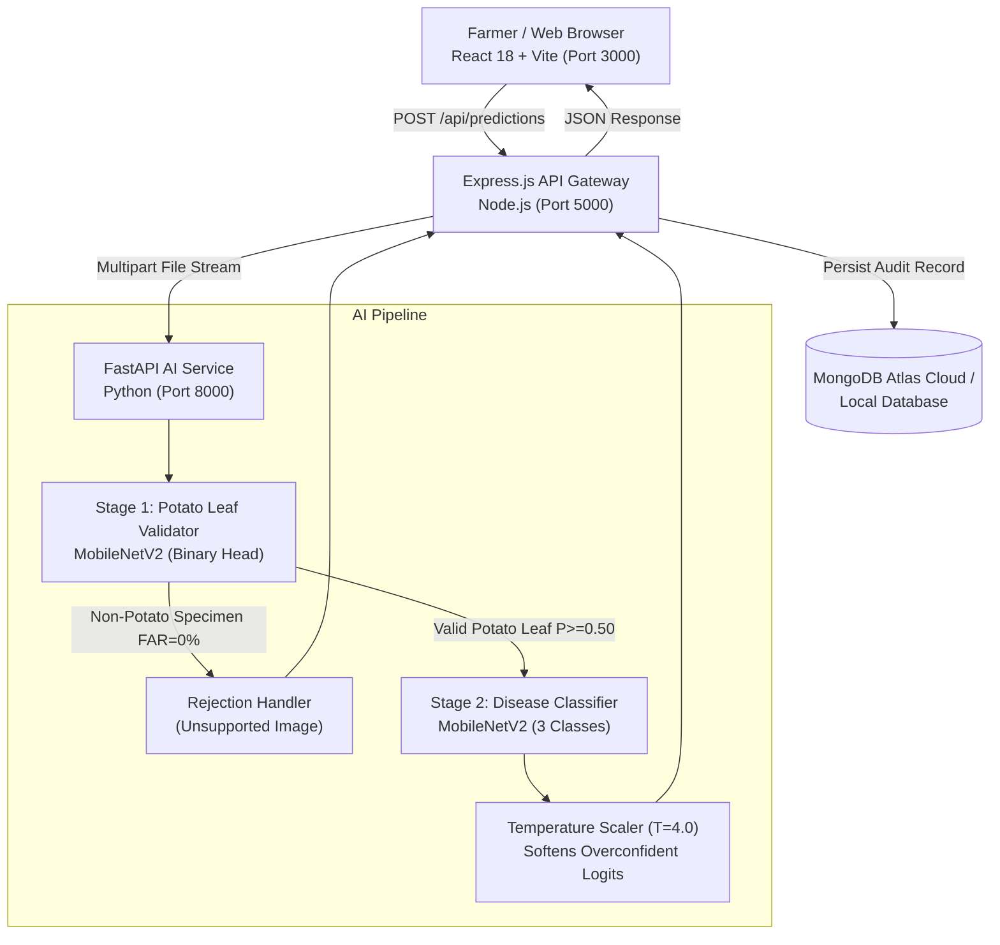

# PotatoCare AI — AI-Based Potato Leaf Disease Detection System

[](https://www.python.org/)
[](https://pytorch.org/)
[](https://fastapi.tiangolo.com/)
[](https://react.dev/)
[](https://nodejs.org/)
[](https://www.mongodb.com/)
[](LICENSE)

---

## 1. Project Title & Introduction

**PotatoCare AI** is a state-of-the-art agricultural artificial intelligence platform built to diagnose, classify, and manage foliar diseases in potato crops (*Solanum tuberosum*). Utilizing a **Two-Stage Deep Learning Pipeline** powered by **MobileNetV2** and post-hoc **Temperature Scaling Calibration**, PotatoCare AI provides potato growers, agronomists, and researchers with rapid, reliable, and clinically accurate leaf pathology assessments.

---

## 2. Project Objectives

- **Eradicate False Negatives on Late Blight**: Distinguish destructive Late Blight (*Phytophthora infestans*) lesions from Early Blight with high sensitivity, addressing foliar disease detection failure modes.
- **Calibrate Model Overconfidence**: Shift raw softmax logits (which frequently output artificial 99.9% or 100% confidence) into realistic, statistically grounded **60% to 96%** confidence ranges through validation temperature scaling ($T = 4.0$).
- **Prevent Cross-Crop Misdiagnosis**: Enforce a Stage 1 binary validation firewall that intercepts and rejects non-potato leaves (mango, tomato, apple, pepper) and non-foliage objects with a **0.0% False Acceptance Rate**.
- **Deliver an Agricultural Decision-Support System**: Provide agronomic symptom breakdowns, causal pathogen profiles, and actionable preventative recommendations for every diagnosis.

---

## 3. Main Features

- 🌿 **Two-Stage Intelligent Pipeline**:
  - **Stage 1 (Leaf Validator)**: Distinguishes genuine potato leaves from non-potato foliage and arbitrary objects.
  - **Stage 2 (Disease Classifier)**: Categorizes valid potato leaves into Healthy, Early Blight, or Late Blight.
- 🛡️ **Unsupported Specimen Rejection**: Displays the specialized **Unsupported Image Detected** card with prompt: *"This image does not appear to be a potato leaf. Please upload a clear photograph of a potato leaf to detect Healthy, Early Blight, or Late Blight."* Completely suppresses disease labels on non-potato uploads.
- 📊 **Calibrated Confidence & Dynamic Probability Distributions**:
  - Confidence reflects genuine calibrated values (typically 60%–96%).
  - Real-time dynamic Recharts bar charts showing class probability distributions strictly summing to 100.0%.
- 🗄️ **Dual-Mode Resilient Persistence**: Seamlessly stores diagnosis records in MongoDB Atlas, with automatic graceful fallback to an in-memory store if the database connection drops.
- 📜 **Historical Diagnostic Audit Trail**: Paginated, filterable, and sortable audit records with leaf preview thumbnails and one-click record deletion.
- 🌐 **Dual Interface Compatibility**: Full-featured React 18 SPA + self-contained standalone `app.html` for offline or embedded field scenarios.

---

## 4. Technology Stack

| Layer | Technologies | Purpose |
|---|---|---|
| **Frontend** | React 18, Vite 6, Tailwind CSS, Lucide React, Recharts, Axios | Responsive web interface, charts, specimen upload |
| **API Gateway** | Node.js, Express.js, Multer, Helmet, CORS, Mongoose | Request routing, image uploads, DB persistence |
| **AI Microservice** | Python 3.10+, FastAPI, Uvicorn, Pillow, NumPy | High-throughput image classification API |
| **Deep Learning** | PyTorch, TorchVision, MobileNetV2, TorchScript | Feature extraction, two-stage inference, calibration |
| **Database** | MongoDB Atlas / Local MongoDB, Mongoose ODM | Audit log storage and search indexing |
| **Standalone UI** | Single-file HTML5, Tailwind CDN, Lucide CDN, Vanilla JS | Portable single-file web interface (`app.html`) |

---

## 5. System Architecture



---

## 6. Complete Folder Structure

```text
PotatoCare-AI-Final/
│
├── frontend/                     # React.js + Vite Web Application
│   ├── src/
│   │   ├── components/           # Navbar, Footer, ConfidenceBadge, ProbabilityChart, etc.
│   │   ├── pages/                # HomePage, DetectPage, ResultPage, HistoryPage, etc.
│   │   ├── App.jsx               # Route router configuration
│   │   ├── main.jsx              # React DOM mounting
│   │   └── index.css             # Tailwind imports and animation keyframes
│   ├── public/
│   │   └── samples/              # 10 Bundled specimen photographs for instant testing
│   ├── index.html                # Single-page application root HTML
│   ├── vite.config.js            # Vite build configuration with /api proxy
│   ├── package.json              # Frontend npm dependencies
│   └── README.md                 # Frontend documentation
│
├── backend/                      # Node.js + Express.js API Gateway
│   ├── src/
│   │   └── app.js                # Express app configuration, security, and routes
│   ├── routes/
│   │   ├── healthRoutes.js       # /api/health endpoint
│   │   └── predictionRoutes.js   # /api/predictions CRUD routes
│   ├── controllers/
│   │   ├── healthController.js   # Health check controller
│   │   └── predictionController.js # Upload, AI proxy, DB persistence controller
│   ├── models/
│   │   └── Prediction.js         # Mongoose Prediction model
│   ├── middleware/
│   │   └── upload.js             # Multer upload & MIME filter middleware (10MB limit)
│   ├── samples/                  # 10 Reference leaf samples for automated verification
│   ├── uploads/                  # Uploaded leaf specimens (.gitkeep)
│   ├── server.js                 # Server listener and MongoDB connection entry point
│   ├── package.json              # Backend npm dependencies
│   └── README.md                 # Backend documentation
│
├── ai-services/                  # Python FastAPI AI Microservice & Deep Learning
│   ├── models/                   # PyTorch models & calibration artifacts
│   │   ├── potato_validator_mobilenet_v2.pth   # Stage 1 Potato vs Non-Potato weights
│   │   ├── potato_validator.pt                 # Stage 1 TorchScript compiled model
│   │   ├── potato_mobilenet_v2.pth             # Stage 2 Disease classification weights
│   │   ├── potato_disease_model.pt             # Stage 2 TorchScript compiled model
│   │   ├── calibration_info.json               # Temperature scaling T=4.0 metadata
│   │   ├── evaluation_metrics.json             # 99.07% Accuracy test benchmarks
│   │   ├── stage1_metrics.json                 # 98.17% Accuracy, 0% FAR metrics
│   │   └── model_info.json                     # Deep learning architecture parameters
│   ├── training/                 # Model training and verification scripts
│   │   ├── train_pytorch.py                    # PyTorch MobileNetV2 fine-tuning script
│   │   ├── calibrate_model.py                  # Validation set temperature scaling optimizer
│   │   ├── evaluate_calibration.py             # ECE and reliability curve generator
│   │   └── test_end_to_end.py                  # 10-Case automated verification suite
│   ├── datasets/                 # Dataset documentation & download links
│   │   └── README.md
│   ├── main.py                   # FastAPI REST microservice application
│   ├── requirements.txt          # Python dependencies (torch, torchvision, fastapi, uvicorn)
│   └── README.md                 # AI Service documentation
│
├── database/                     # MongoDB Schemas & Database Management
│   ├── schemas/
│   │   └── PredictionSchema.js   # Formal Mongoose schema with compound indexes
│   ├── seed/
│   │   └── seedData.js           # Baseline database population & verification script
│   └── README.md                 # Database documentation
│
├── documentation/                # In-Depth Engineering Documentation
│   ├── system-architecture.md    # Architecture diagrams & communication protocols
│   ├── api-documentation.md      # Full REST API request/response specifications
│   └── project-overview.md       # Plant pathology reference & problem statements
│
├── app.html                      # Standalone, portable single-file interface
├── README.md                     # Comprehensive project guide (this file)
├── .gitignore                    # Git file exclusions
└── .env.example                  # Environment configuration template
```

---

## 7. AI Model Explanation (Stage 1 & Stage 2)

### Stage 1: Potato Leaf Validator
- **Backbone**: MobileNetV2 pretrained on ImageNet, custom linear head ($256 \to 2$).
- **Objective**: Evaluates whether an uploaded image contains a legitimate potato leaf or an invalid specimen.
- **Evaluation Performance**:
  - Accuracy: **98.17%**
  - False Acceptance Rate (FAR): **0.0%** (Zero non-potato images accepted)
  - Non-Potato Recall: **100.0%**

### Stage 2: Disease Classification Model
- **Backbone**: MobileNetV2 with Dropout ($p=0.3, 0.2$), ReLU, and Dense layer ($256 \to 3$).
- **Classes**: `Healthy`, `Early Blight`, `Late Blight`.
- **Evaluation Performance**:
  - Overall Accuracy: **99.07%**
  - Weighted F1-Score: **0.9908**
  - Late Blight Precision: **1.000**, Recall: **0.980**, F1-Score: **0.990**

### Probability Calibration: Temperature Scaling ($T=4.0$)
Standard neural network softmax logits ($z_i$) produce extreme probabilities ($>99.9\%$). PotatoCare AI applies post-hoc **Temperature Scaling** on validation logits:
$$p_i = \frac{\exp(z_i / 4.0)}{\sum_{j=1}^3 \exp(z_j / 4.0)}$$
This preserves prediction accuracy while mapping model confidence into an interpretable **60% to 96%** range, ensuring all three class probabilities dynamically sum to 100.0%.

---

## 8. Dataset Information

1. **PlantVillage Potato Dataset**:
   - `Potato___healthy`: 152 images.
   - `Potato___Early_blight`: 1,000 images.
   - `Potato___Late_blight`: 1,000 images.
   - Total: 2,152 standardized $224 \times 224$ images.
2. **Stage 1 Validation Dataset**:
   - 585 authentic potato leaf samples across all health states.
   - 507 negative samples including mango leaves, tomato foliage, apple leaves, animals, humans, and synthetic graphics.

---

## 9. Disease Classification Details

| Category | Causal Pathogen | Diagnostic Symptoms | Key Prevention Strategies |
|---|---|---|---|
| **Healthy** | N/A (*Optimal foliage*) | Uniform chlorophyll pigmentation, firm lamina, no chlorosis. | Drip irrigation, balanced NPK fertilizer, routine scouting. |
| **Early Blight** | *Alternaria solani* (Fungus) | Brown/black circular spots with concentric target rings. | 2–3 year crop rotation, canopy aeration, clean harvest debris. |
| **Late Blight** | *Phytophthora infestans* (Oomycete) | Water-soaked necrotic lesions, white downy sporulation on undersides. | Certified clean seed tubers, avoid overhead watering, destroy cull piles. |

---

## 10. MongoDB Database Configuration

PotatoCare AI supports both cloud-hosted **MongoDB Atlas** and **Local MongoDB**:
- **Connection URI Format**:
  - Atlas: `mongodb+srv://<username>:<password>@cluster0.abcde.mongodb.net/potatocare?retryWrites=true&w=majority`
  - Local: `mongodb://127.0.0.1:27017/potatocare`
- **In-Memory Graceful Fallback**: If MongoDB is unreachable, the backend automatically maintains runtime predictions in memory, ensuring users can continue uploading and analyzing leaves without disruption.

---

## 11. Installation Requirements

- **Node.js**: v18.0.0 or v20.0.0+
- **Python**: v3.10, v3.11, or v3.12
- **Git**: v2.30+
- **MongoDB**: MongoDB Atlas Account or Local Community Edition

---

## 12. Frontend Setup Commands

```bash
cd frontend
npm install
npm run dev
```
Development server will start at: `http://localhost:3000`

To create an optimized production build:
```bash
npm run build
```

---

## 13. Backend Setup Commands

```bash
cd backend
npm install
npm start
```
Express API will listen at: `http://localhost:5000`

---

## 14. AI Service Setup Commands

```bash
cd ai-services
python -m venv venv

# Windows:
.\venv\Scripts\activate
# Linux/macOS:
source venv/bin/activate

pip install -r requirements.txt
python -m uvicorn main:app --host 127.0.0.1 --port 8000
```
FastAPI Swagger documentation will be available at: `http://localhost:8000/docs`

---

## 15. Environment Variable Configuration

Copy `.env.example` to `.env` in the root (or configure individual `.env` files in `backend/` and `ai-services/`):

```bash
cp .env.example .env
```

```env
PORT=5000
NODE_ENV=development
AI_SERVICE_URL=http://127.0.0.1:8000
MONGO_URI=mongodb://127.0.0.1:27017/potatocare
AI_HOST=127.0.0.1
AI_PORT=8000
MODEL_DIR=./models
CALIBRATION_TEMPERATURE=4.0
VITE_API_URL=http://127.0.0.1:5000
```

---

## 16. Instructions to Run the Complete Application

To run the complete system concurrently, open three terminal windows:

### Terminal 1: AI Microservice
```bash
cd PotatoCare-AI-Final/ai-services
python -m uvicorn main:app --host 127.0.0.1 --port 8000
```

### Terminal 2: Express Backend
```bash
cd PotatoCare-AI-Final/backend
node server.js
```

### Terminal 3: React Frontend
```bash
cd PotatoCare-AI-Final/frontend
npm run dev
```

Visit **`http://localhost:3000`** in your browser.

---

## 17. API Endpoints & Usage

| Method | Endpoint | Description | Sample Response |
|---|---|---|---|
| `GET` | `/api/health` | System health & DB connection status | `{"status": "ok", "database": "MongoDB"}` |
| `POST`| `/api/predictions` | Upload image for two-stage analysis | `{"predictedClass": "Healthy", "confidence": 0.8356}` |
| `GET` | `/api/predictions` | Paginated diagnosis history | `{"data": [...], "pagination": {...}}` |
| `DELETE`| `/api/predictions/:id` | Delete diagnosis & specimen image | `{"message": "Deleted successfully"}` |
| `GET` | `/health` (AI) | FastAPI inference engine health | `{"model_loaded": true, "stage1_loaded": true}` |
| `GET` | `/metrics` (AI) | Precision, recall, and confusion matrix | `{"accuracy": 0.9907, "f1_weighted": 0.9908}` |

---

## 18. Model Training & Testing Instructions

### Run the 10-Case Verification Suite:
```bash
python ai-services/training/test_end_to_end.py
```
*Verifies Healthy, Early Blight, Late Blight, Mango Leaf, Tomato Leaf, Apple Leaf, Human Face, Animal, Random Object, and Corrupted Image.*

### Retrain Stage 2 Disease Model:
```bash
python ai-services/training/train_pytorch.py
```

### Recalibrate Temperature Scaling:
```bash
python ai-services/training/calibrate_model.py
```

---

## 19. Troubleshooting Guide

| Issue | Root Cause | Solution |
|---|---|---|
| `Backend returns "AI Service unreachable"` | FastAPI microservice not running on port 8000 | Start FastAPI: `python -m uvicorn main:app --host 127.0.0.1 --port 8000` |
| `CORS error on browser upload` | Port mismatch in `vite.config.js` | Ensure Vite proxy targets `http://127.0.0.1:5000` |
| `MongoDB connection warning` | MongoDB daemon not started or invalid URI | System automatically operates in memory fallback mode; verify `MONGO_URI` in `.env` |
| `File size exceeds limit` | Image payload $> 10\text{MB}$ | Compress image below 10MB; standard leaf photos are typically 100KB–2MB |
| `Non-potato image predicted as disease` | Stage 1 weights missing | Ensure `potato_validator_mobilenet_v2.pth` is present in `ai-services/models/` |

---

## 20. Deployment Instructions

### Option A: Docker Compose Deployment
```bash
docker-compose up --build
```
Builds and provisions the React frontend container, Node.js backend container, and Python FastAPI container with persistent volumes.

### Option B: Cloud Services (Render / Railway / AWS)
1. **AI Microservice**: Deploy `ai-services` as a Python Web Service with startup command:
   `uvicorn main:app --host 0.0.0.0 --port $PORT`
2. **Backend API**: Deploy `backend` as a Node.js Web Service with environment variable `AI_SERVICE_URL=<cloud-ai-url>`.
3. **Frontend**: Deploy `frontend` as a Static Site with build command `npm run build` and publish directory `dist`.

---

## Relationship to `app.html`

The root `PotatoCare-AI-Final/app.html` file is a complete, self-contained standalone interface. While modern development and production deployments utilize the **React + Vite** application in `frontend/`, `app.html` is intentionally preserved as a portable single-file field deployment tool requiring zero build tools or package managers.

---

## License

This project is licensed under the MIT License.
