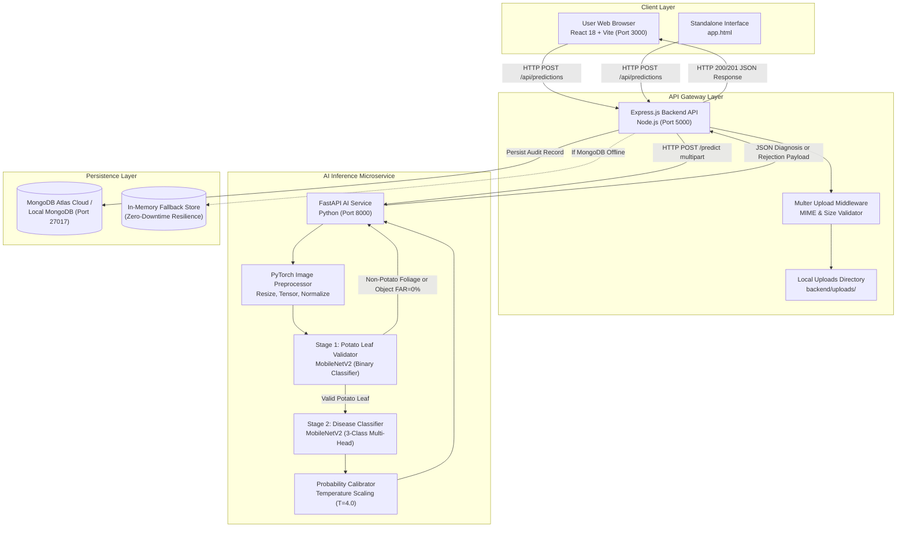
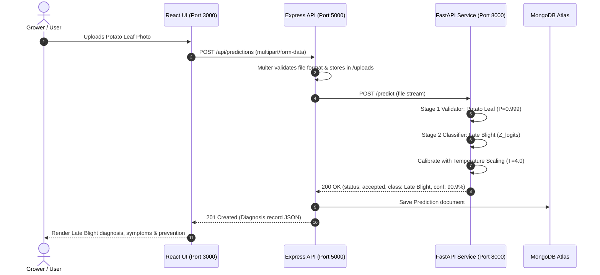
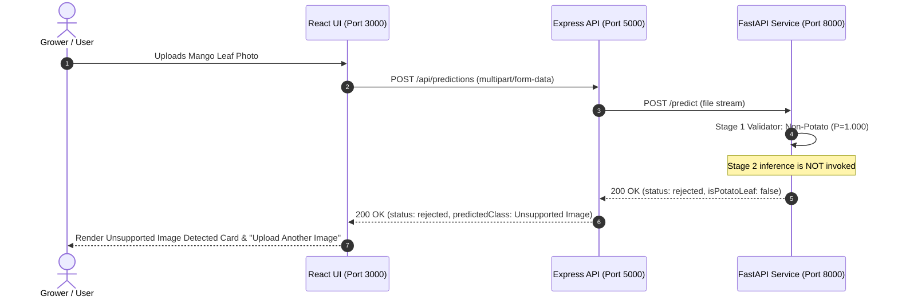

# PotatoCare AI — System Architecture & Technical Design

This document details the complete end-to-end system architecture, service communications, pipeline sequencing, and security boundaries for **PotatoCare AI**.

---

## 1. High-Level Architecture Diagram

---

## 2. Component Specifications

### 2.1 Frontend Client (React 18 + Vite)
- **Port**: `3000` (Dev server) or static build served via Express / Nginx.
- **Key Modules**:
  - `DetectPage`: Drag-and-drop file upload, file validation, 10 quick-test sample buttons.
  - `ResultPage`: Dual-branch presentation. Renders the **Unsupported Image Detected** card on rejection, or the comprehensive disease diagnosis card with calibrated probability charts on acceptance.
  - `HistoryPage`: Audit log viewer with class filtering, timestamp sorting, and record deletion.
  - `ConfidenceBadge`: Specialized component for rendering calibrated confidence with raw softmax tooltips.
  - `ModelStatusBanner`: Real-time ping checking FastAPI health, model loading state, and inference engine.

### 2.2 API Gateway (Node.js + Express)
- **Port**: `5000`
- **Responsibilities**:
  - Enforces CORS policies and Helmet HTTP security headers.
  - Manages image uploads up to 10MB; sanitizes file extensions and MIME headers.
  - Multiplexes requests to the Python FastAPI microservice.
  - Persists diagnostic history into MongoDB Atlas (or in-memory store if offline).

### 2.3 AI Microservice (Python + FastAPI + PyTorch)
- **Port**: `8000`
- **Responsibilities**:
  - Hosts the Two-Stage PyTorch deep learning pipeline.
  - **Stage 1 (Potato vs Non-Potato)**: Validates that the specimen is genuine potato foliage (*Solanum tuberosum*). Rejects mango leaves, tomato leaves, apple foliage, humans, animals, and synthetic graphics with **0% False Acceptance Rate**.
  - **Stage 2 (Disease Classification)**: Classifies potato leaves into `Healthy`, `Early Blight` (*Alternaria solani*), or `Late Blight` (*Phytophthora infestans*) with **99.07% test accuracy**.
  - **Calibration Layer**: Employs Temperature Scaling ($T=4.0$) so that probabilities fall into realistic 60%–96% confidence bands, strictly summing to 100.0%.

### 2.4 Database Layer (MongoDB)
- **Port**: `27017` (or MongoDB Atlas Cloud SRV).
- **Collection**: `predictions`.
- **Indexing**: Compound indices on `{ predictedClass: 1, createdAt: -1 }` and `{ status: 1, createdAt: -1 }`.

---

## 3. Communication Sequences

### 3.1 Valid Potato Leaf Diagnosis Flow

### 3.2 Non-Potato Image Rejection Flow

---

## 4. Security & Safety Controls

1. **Path Traversal Protection**: File paths for deletion are validated strictly against the resolved `uploads/` directory boundary.
2. **Payload Size Limits**: 10MB maximum payload restriction on Express and FastAPI.
3. **MIME & Magic Header Inspection**: Only authentic JPEG and PNG files are processed.
4. **Environment Isolation**: Database connection strings, API keys, and sensitive tokens are strictly loaded via `.env`.
